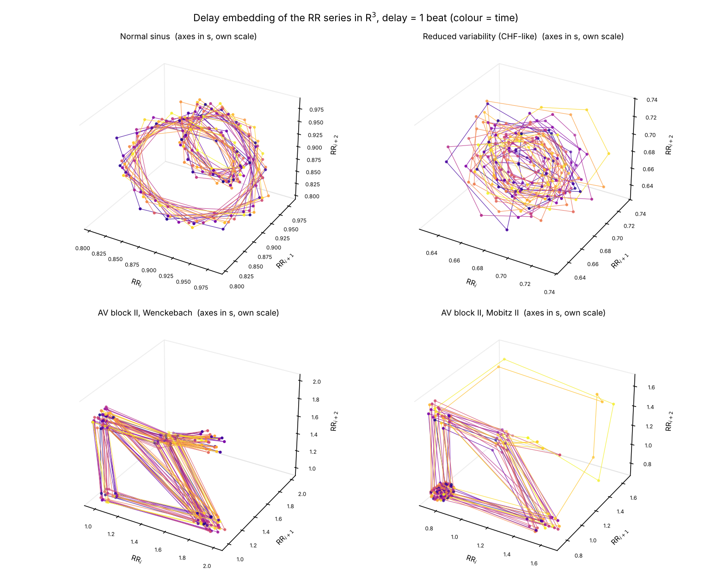
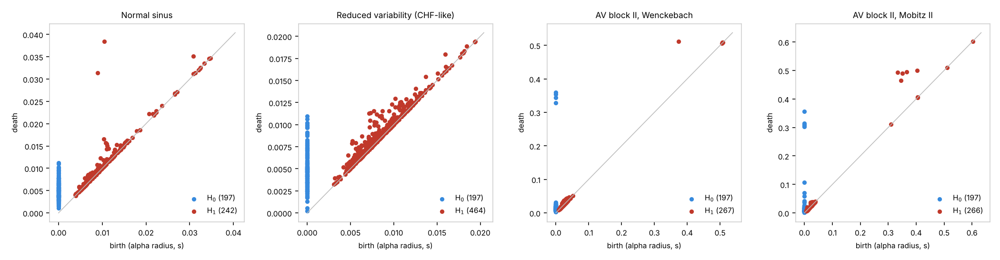

# ECG topology

Topological data analysis of RR-interval series: a research prototype for detecting heart failure and atrioventricular (AV) block from the shape of the heartbeat dynamics.

**Status: research proposal with a working prototype.** The pipeline runs end to end on synthetic data. It has not been validated on real recordings yet.

---

## Idea

A scalar series such as the RR intervals of an ECG can be turned into a point cloud by delay embedding (Takens). If the heart rhythm is quasi-periodic, the cloud has a loop; if it is irregular, the loop breaks up; if beats are dropped, outlying clusters appear. Persistent homology measures these structures at all scales without choosing a threshold, and its summaries can feed a classifier.

```
RR series ──► delay embedding ──► alpha filtration ──► persistent homology ──► features ──► classifier / window score
              (R^3, delay in beats)   (GUDHI)            (H0, H1)               (9 features)
```

Research questions:

1. How should Takens' embedding be applied to physiological series, and with which parameters?
2. Which topological features are most informative for cardiac classification?
3. Can persistent homology detect changes in cardiac dynamics before they are clinically manifest in heart failure?
4. Does restricting the embedding to $d \le 3$ give a useful trade-off between cost and clinical interpretability?

## Quick start

Requires Python 3.12 or later and [uv](https://docs.astral.sh/uv/).

```bash
uv sync
uv run pytest                          # unit tests
uv run python scripts/run_demo.py      # synthetic demo, ~40 s, writes figures/
```

```python
from ecgtda import synthetic, tda_features, hrv_features

series = synthetic.generate("mobitz1", n_beats=200, seed=1)   # Wenckebach block
tda_features(series.rr)    # {'h0_max': ..., 'h1_entropy': ..., ...}
hrv_features(series.rr)    # {'sdnn': ..., 'rmssd': ..., ...}
```

Rhythm kinds: `nsr`, `chf`, `av1`, `mobitz1`, `mobitz2`, `pavb`. See [docs/03-synthetic-demo.md](docs/03-synthetic-demo.md).

## Synthetic demo

The generator simulates atrial rhythm and AV conduction, so block patterns come out of the conduction model. Ground truth is known, which allows a negative control: first-degree block does not change the RR series and must not be separable.





| 3-class task: normal vs CHF-like vs AV block II | Random forest | SVM |
|---|---|---|
| HRV baseline (SDNN, RMSSD, pNN50, ...) | 0.983 | 0.944 |
| Topological features | 0.967 | 0.946 |
| HRV + topological | 0.972 | 0.962 |

Accuracy, 5-fold cross-validation repeated 3 times, 80 windows per class. Negative control (normal vs first-degree block): about 0.5 for all feature sets.

What this means. The code works and the diagrams look like the theory says. On synthetic data topological features do about as well as classical HRV and not better, and a pause detector as simple as the longest RR interval matches them on paroxysmal block. That is expected, because the generator only contains effects HRV also sees. Whether topology adds information is the open question this project is built to answer, on real recordings. The demo is not evidence about patients.

## Repository layout

```
ecgtda/               Python package
  synthetic.py          synthetic RR generators (6 rhythm kinds)
  embedding.py          Takens embedding, delay selection by mutual information
  topology.py           alpha-complex persistent homology (GUDHI), diagram features
  hrv.py                classical HRV baseline features
  pipeline.py           RR -> cloud -> features, sliding windows
scripts/run_demo.py   synthetic demo: figures and results table
tests/                unit tests
figures/              demo output (PNG and demo_results.md)
docs/                 technical documentation
thesis_bg/            background document (thesis_tda_ecg.docx)
notebooks/            earlier exploration of single heartbeats (see note)
```

Note on `notebooks/`. This folder holds the first exploration: Takens embeddings of single MIT-BIH heartbeats from the 187-sample CSV format. It is a different object from the RR pipeline above (one beat versus the beat-to-beat series), so it is not connected to `ecgtda`. `Processing.py` and `EDA.ipynb` read from hard-coded `C:\CODE\...` paths and need the CSV files (git-ignored) to run.

## Documentation

| Document | Content |
|---|---|
| [01 Theoretical background](docs/01-theoretical-background.md) | persistent homology, filtrations, Takens, stability, feature definitions |
| [02 Methodology](docs/02-methodology.md) | detection targets, pipeline, open design decisions, validation plan |
| [03 Synthetic demo](docs/03-synthetic-demo.md) | generator, results, what the demo can and cannot show |
| [References](docs/references.md) | bibliography with verification status |

## Roadmap

- [ ] Real data: RR series from PhysioNet (Congestive Heart Failure RR Interval Database and a normal-rhythm counterpart), subject-wise splits
- [ ] R-peak detection and ectopic-beat handling for raw ECG
- [ ] Decide what is embedded: RR series or the ECG waveform (see methodology, 2.3)
- [ ] Sensitivity analysis: embedding dimension, delay, $H_1$ threshold, window length
- [ ] Compare against HRV (time and frequency domain) and a longest-RR detector with confidence intervals
- [ ] Source with annotated paroxysmal AV block, or reframe that target
- [ ] Multi-lead ECG with multivariate persistence; other signals (EEG, respiration)

## Key references

Full list in [docs/references.md](docs/references.md).

- Edelsbrunner, Letscher & Zomorodian (2002), *Topological persistence and simplification*.
- Takens (1981), *Detecting strange attractors in turbulence*.
- Cohen-Steiner, Edelsbrunner & Harer (2007), *Stability of persistence diagrams*.
- Graff et al. (2021), *Persistent homology as a new method of the assessment of heart rate variability*, PLOS ONE 16(7).
- Emrani, Gentimis & Krim (2014), *Persistent homology of delay embeddings and its application to wheeze detection*.

## Citation

```bibtex
@misc{villarreal2026ecgtopology,
  author = {Villarreal De La Cerda, Diego},
  title  = {Topological data analysis of RR-interval series for heart failure and AV block detection},
  year   = {2026},
  note   = {Research proposal and prototype code},
  url    = {https://github.com/DiegoVilla03/ecg_topology}
}
```

Diego Villarreal De La Cerda, 2026.
