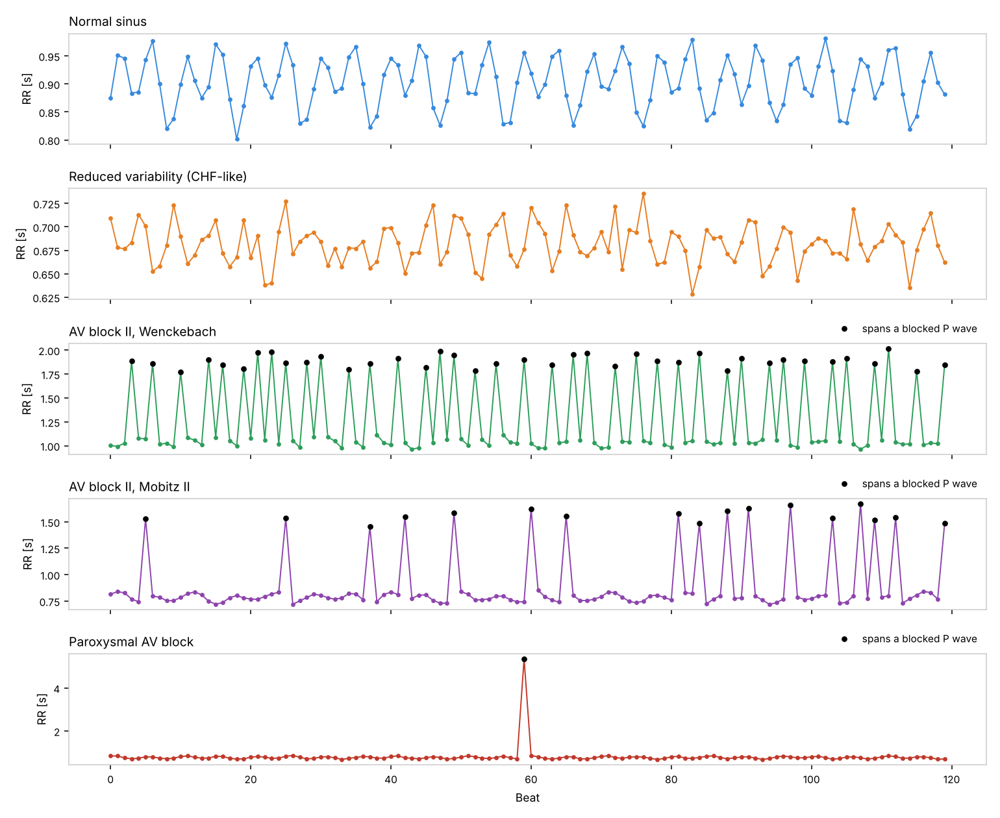
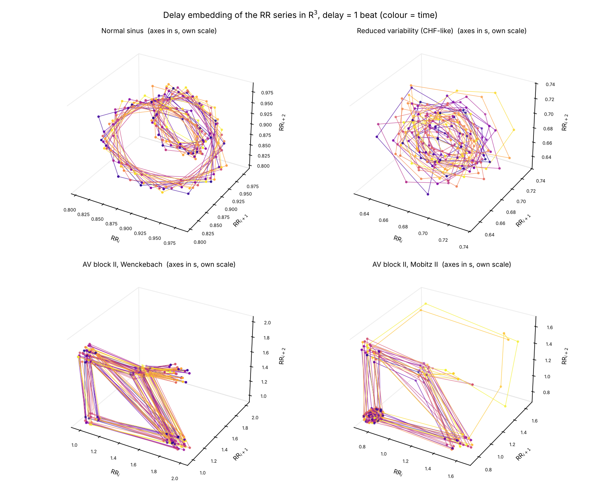
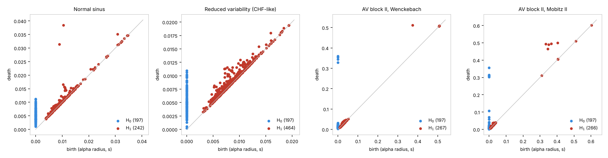
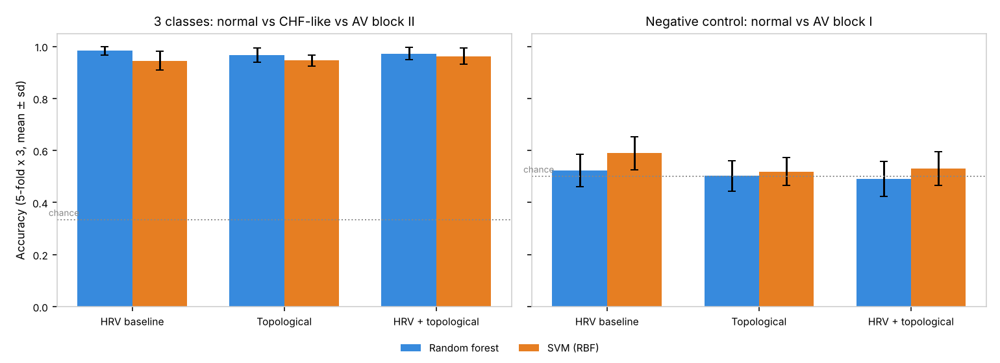
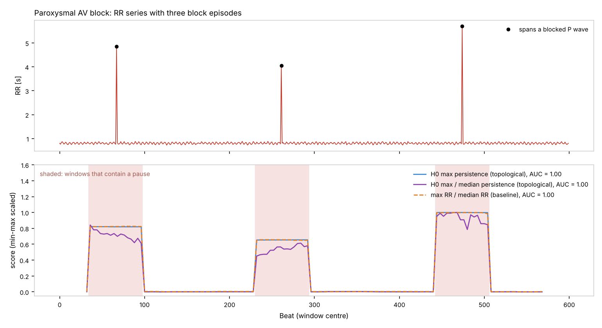

# 3. Synthetic demo

`scripts/run_demo.py` runs the whole chain on synthetic RR series: generation, delay embedding, persistent homology, features, classification and sliding-window detection. It takes about 40 seconds and writes figures and a results table to `figures/`.

```
uv run python scripts/run_demo.py
```

## 3.1 What it is for

Real annotated recordings are not in the repository yet. Synthetic series have known ground truth, so they can be used to:

- check that the code does what the theory says (unit tests in `tests/`);
- look at what the embedding and the diagrams of each rhythm class look like;
- compare topological features against a classical HRV baseline in a controlled setting;
- include a **negative control**, a class the pipeline should *not* be able to separate.

## 3.2 What it cannot show

The generator is written by the author and contains the effects the thesis hypothesises (less variability in heart failure, pauses in AV block). A good result on it shows the code works. It is **not evidence about patients**, and it cannot show that topology adds anything over HRV, because every effect built into the generator is also visible to HRV.

## 3.3 Generator (`ecgtda/synthetic.py`)

Two stages.

1. **Atrial rhythm.** P-wave times with a mean interval, a respiratory oscillation (0.20 to 0.30 Hz), a slower Mayer-wave oscillation (0.08 to 0.12 Hz) and Gaussian noise. Parameters are drawn per subject from the ranges below.
2. **AV conduction.** Each P wave is either conducted (R peak after a PR delay, 3 ms jitter) or blocked.

| Kind | Atrial profile | Conduction |
|---|---|---|
| `nsr` | mean interval 0.75 to 1.00 s, respiratory 20 to 60 ms, Mayer 8 to 35 ms | 1:1, PR 140 to 200 ms |
| `chf` | mean interval 0.60 to 0.85 s, respiratory 3 to 25 ms, Mayer 2 to 15 ms | 1:1 |
| `av1` | as `nsr` | 1:1, PR constant at 240 to 340 ms |
| `mobitz1` | as `nsr` | PR grows with decreasing increments (total gain 100 to 220 ms) over cycles of 3 to 5 P waves, then one blocked |
| `mobitz2` | as `nsr` | constant PR, a P wave is blocked with probability 0.08 to 0.25, never two in a row |
| `pavb` | as `nsr` | 1:1 with episodes of 3 to 6 consecutive blocked P waves |

Wenckebach and Mobitz II patterns arise from simulating the conduction, not from hand-drawn RR shapes. The ranges of `nsr` and `chf` overlap on purpose, so the classification task is not trivial.

## 3.4 Results

80 windows per class, 200 beats each, seed 7. Stratified 5-fold cross-validation repeated 3 times. Full table in [`figures/demo_results.md`](../figures/demo_results.md).







**Embedding and diagrams.** Normal sinus rhythm, with two oscillations of different frequency, fills a ring-like surface in $\mathbb{R}^3$. Its $H_1$ diagram shows a few classes well above the diagonal. The reduced-variability cloud is a small unstructured blob and its diagram sits near the diagonal. In both second-degree blocks the cloud splits into clusters separated by the pause intervals, which shows up as long-lived $H_0$ classes.



| Task | Features | Random forest | SVM (RBF) |
|---|---|---|---|
| Normal vs CHF-like vs AV block II (chance 0.33) | HRV baseline | 0.983 | 0.944 |
| | Topological | 0.967 | 0.946 |
| | HRV + topological | 0.972 | 0.962 |
| Normal vs AV block I (chance 0.50) | HRV baseline | 0.523 | 0.590 |
| | Topological | 0.502 | 0.519 |
| | HRV + topological | 0.492 | 0.531 |

Accuracy, mean over folds and repeats; standard deviations are 0.02 to 0.07.

- Topological features separate the three classes about as well as the HRV baseline, and not better. Adding them to HRV does not change the picture beyond the noise of the estimate.
- The negative control sits at chance for every feature set, as it must: first-degree block leaves the RR series unchanged.



Window-level detection of a pause (64-beat windows, step 4): AUC 1.00 for $H_0$ max persistence, for $H_0$ max over median, and for the longest-RR baseline. The topological score and the baseline are visually indistinguishable. Topology does flag the episodes, but a one-line threshold does too, so paroxysmal block as a pure pause detection problem does not need topology. The case for it has to rest on subtler changes in real recordings.

## 3.5 Reproducibility

Everything is seeded, so rerunning the script reproduces the figures and the table exactly. The standard deviations across folds (0.02 to 0.07) give the scale of the sampling uncertainty; differences between feature sets smaller than that should not be interpreted. Tests (`uv run pytest`) check the embedding, that a circle yields one dominant $H_1$ class, that Wenckebach RR shortens within a cycle, that Mobitz II pauses last about two atrial intervals, and that first-degree block is invisible in RR.
